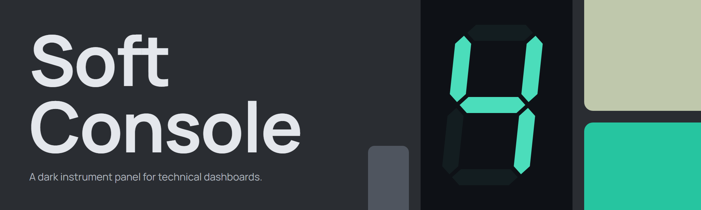
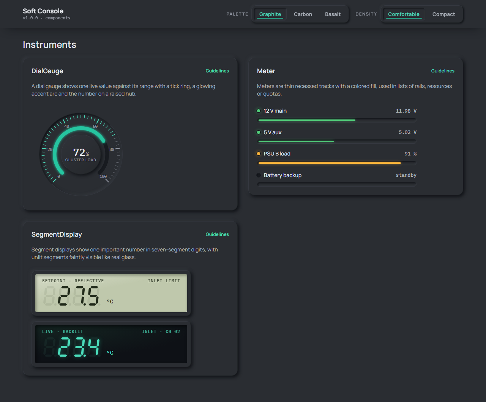
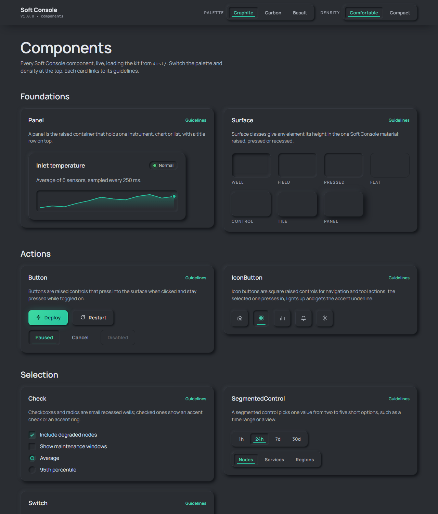

A dark neumorphic design system for technical dashboards. One soft material shaped into an instrument panel: height carries meaning, a single accent marks values and the main action, and a small hardware vocabulary does the talking. That vocabulary is segment displays, LEDs, tick-marked dials and a jog wheel.

It ships as three plain files: design tokens, a component stylesheet and a small helper script with no dependencies. It works with any framework, or with none.



## Quick start

Load the three files in this order. Pin the version in the URL.

```html
<link rel="stylesheet" href="https://cdn.jsdelivr.net/gh/zym35/soft-console@v1.0.0/dist/tokens.css">
<link rel="stylesheet" href="https://cdn.jsdelivr.net/gh/zym35/soft-console@v1.0.0/dist/soft-console.css">
<script src="https://cdn.jsdelivr.net/gh/zym35/soft-console@v1.0.0/dist/soft-console.js"></script>
```

Or install from GitHub and import the files from `node_modules/soft-console/dist/`:

```bash
npm install github:zym35/soft-console#v1.0.0
```

You can also copy `dist/` into your project. Then write markup with the `sc-` classes and call `SoftConsole.init()`:

```html
<html data-theme="graphite-teal">
  <body class="sc-root">
    <section class="sc-panel sc-raised-2">
      <div class="sc-panel__head"><h3 class="sc-panel__title">Load</h3><span class="sc-label">All nodes</span></div>
      <div data-sc-gauge="72" data-label="Cluster load"></div>
    </section>
    <script>SoftConsole.init(document.body);</script>
  </body>
</html>
```

`init` mounts the icon sprite and wires selection groups, switches, toggles and sliders. It also draws every `data-sc-seg`, `data-sc-gauge`, `data-sc-spark`, `data-sc-bars`, `data-sc-jog` and `data-sc-count` element. To draw from live data, call `SoftConsole.segment`, `.gauge`, `.spark`, `.lines`, `.bars` and `.jog` directly.

## Palettes and density

Three palettes ship as themes. Set one on `<html>` or from a preferences screen:

| `data-theme` | Name | Character |
| --- | --- | --- |
| `graphite-teal` | Graphite · Teal | Default. Neutral cool graphite with a teal signal. |
| `carbon-cyan` | Carbon · Cyan | Darker and almost neutral. Crisp, high-tech. |
| `basalt-lime` | Basalt · Lime | Olive-black with an LCD-green signal. |

```js
SoftConsole.setTheme('carbon-cyan');
SoftConsole.setDensity('compact'); // 36px controls for dense ops screens; 'comfortable' (44px) is the default
```

Every text color meets WCAG AA (4.5:1) on the surface in all three palettes. The contrast table is in the [guidelines](docs/guidelines.md#text).

## Components

| Group | Components |
| --- | --- |
| Foundations | [Surface](docs/components/Surface.md), [Panel](docs/components/Panel.md) |
| Actions | [Button](docs/components/Button.md), [IconButton](docs/components/IconButton.md) |
| Selection | [SegmentedControl](docs/components/SegmentedControl.md), [Switch](docs/components/Switch.md), [Check](docs/components/Check.md) |
| Inputs | [Slider](docs/components/Slider.md), [Field](docs/components/Field.md), [JogWheel](docs/components/JogWheel.md) |
| Status | [StatusChip](docs/components/StatusChip.md), [AlertList](docs/components/AlertList.md) |
| Instruments | [SegmentDisplay](docs/components/SegmentDisplay.md), [DialGauge](docs/components/DialGauge.md), [Meter](docs/components/Meter.md) |
| Data | [KpiTile](docs/components/KpiTile.md), [BarChart](docs/components/BarChart.md), [LineChart](docs/components/LineChart.md), [DataTable](docs/components/DataTable.md) |

Open [`examples/index.html`](examples/index.html) in a browser to see every component live, with the palette and density switches.



## The rules in brief

1. **Raised means you can press it**, or it is a panel that holds things.
2. **Pressed in means on.** Selected items sink in, turn accent and get an accent underline.
3. **Recessed means data.** Values, inputs and charts sit in wells, never on bumps.
4. **Accent means value or the main action.** One primary button per view.
5. **Every shape has a hairline edge**, so shapes stay readable on dim screens.

The full brand book (color roles, type, shape, density, states, motion, content and iconography) is in [docs/guidelines.md](docs/guidelines.md).

## Customizing tokens

Every color, shadow and length is derived from a few numbers per palette in [`tools/build-tokens.mjs`](tools/build-tokens.mjs). Change a palette's hue, saturation and lightness there, or add a new palette, then rebuild:

```bash
npm run build:tokens
```

This rewrites `dist/tokens.css` and `dist/tokens.json` and prints a contrast report for every palette. Node 18 or newer is required.

## Notes

- Fonts: Manrope (interface) and IBM Plex Mono (numbers) load from Google Fonts through an `@import` at the top of `soft-console.css`. To self-host, remove that line and declare the two families yourself.
- Motion respects `prefers-reduced-motion`: gauges, count-ups, chart reveals and entrance animations switch off.
- Dark only by design. There is no light theme.
- Browser support: current Chrome, Edge, Firefox and Safari. The kit uses `color-mix()`, `@property` and `:focus-visible`.

## License

[MIT](LICENSE) © 2026 King Zhou
