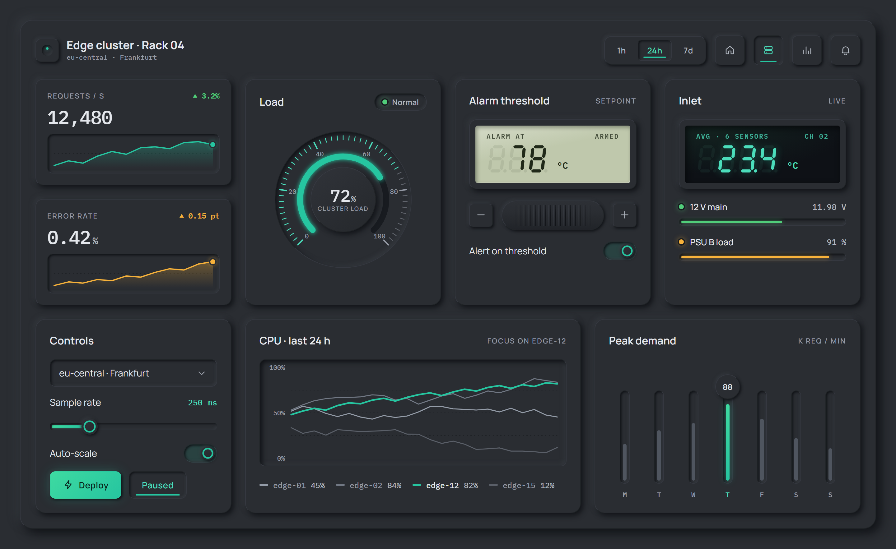

# Soft Console

A dark neumorphic design system for technical dashboards. Three plain files with no dependencies and nothing to build.

### ▶ [Live demo](https://zym35.github.io/soft-console/)



## Use it

Copy `dist/` into your project and link the files:

```html
<link rel="stylesheet" href="dist/tokens.css">
<link rel="stylesheet" href="dist/soft-console.css">
<script src="dist/soft-console.js"></script>
<script>SoftConsole.init(document.body);</script>
```

Set a palette with `data-theme` on `<html>`: `graphite-teal` (default), `carbon-cyan` or `basalt-lime`. Add `data-density="compact"` for dense screens.

## Docs

- [Guidelines](docs/guidelines.md): principles, color, type, motion and copy
- [Components](docs/components): markup and usage for all 19 components

## License

[MIT](LICENSE) © 2026 King Zhou
