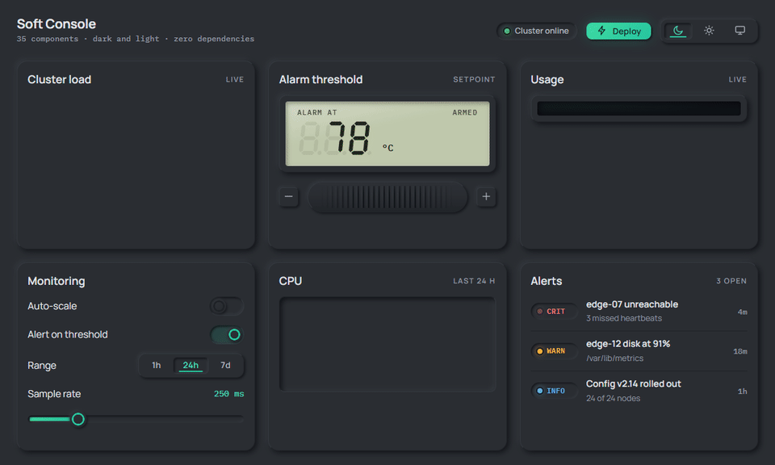

# Soft Console

A neumorphic design system for technical dashboards, in dark and light. Three plain files with no dependencies and nothing to build.

### ▶ [Live demo](https://zym35.github.io/soft-console/)



## Use it

Copy `dist/` into your project and link the files:

```html
<link rel="stylesheet" href="dist/tokens.css">
<link rel="stylesheet" href="dist/soft-console.css">
<script src="dist/soft-console.js"></script>
<script>SoftConsole.init(document.body);</script>
```

Set a palette with `data-theme` on `<html>`: `graphite-teal` (default) or `carbon-cyan`. Set `data-mode="light"` for light mode, or `data-mode="auto"` to follow the operating system; dark is the default. Add `data-density="compact"` for dense screens. From script, use `SoftConsole.setTheme`, `SoftConsole.setMode` and `SoftConsole.setDensity`.

## Docs

- [Guidelines](docs/guidelines.md): principles, color, type, motion and copy
- [Components](docs/components): markup and usage for all 38 components
- [Motion lab](https://zym35.github.io/soft-console/examples/motion.html): every moving part on one page, with a ten-times slow-motion switch

## License

[MIT](LICENSE) © 2026 King Zhou
